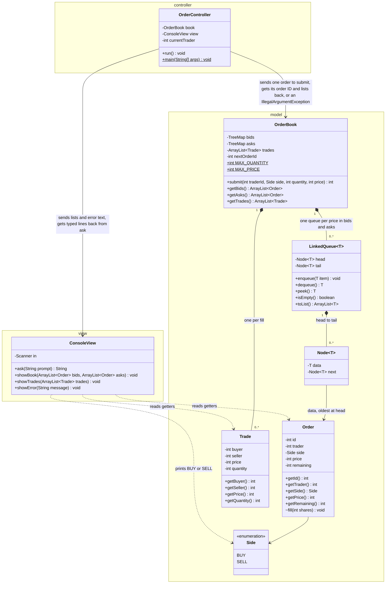

# Preliminary Spec

Project Name: No Cutting!

Revised November 11, 2026, after Deliverable 2. Traders and orders are now identified by `int` IDs, the controller reads commands, and the order-cancellation change feature for Deliverable 4 is specified at the end. Each change is listed under "Revised after Deliverable 2". The Deliverable 2 text is in git at commit `e55516d`. Riya and Raghul have not yet reviewed these revisions; integration rule 1 below requires all three of us to agree before they are final.

## Class design, split by role

| Class | Role | Responsibility |
|---|---|---|
| `LinkedQueue<T>` | Model | Holds items in arrival order; first in, first out. |
| `Side` | Model | Names the two sides of the book: BUY and SELL. |
| `Order` | Model | One trader's order: its ID, who placed it, which side, what price, how many shares are still unfilled. |
| `Trade` | Model | Record of one fill: buyer, seller, price, shares. |
| `OrderBook` | Model | Keeps both sides of the book; checks, numbers and matches each new order; records the trades. |
| `ConsoleView` | View | Prints the book, the trade log and messages; reads what the user types. |
| `OrderController` | Controller | Remembers which trader is typing, turns typed commands into `submit` calls and tells the view what to show. |

`LinkedQueue` also has a private nested class `Node<T>` (model) that links one item to the next.

## System diagram

Arrows run from the class that holds the reference to the class it uses, and each label says what moves along it. The only arrows that cross a package line start at `OrderController`, plus the dashed ones where `ConsoleView` reads `Order`, `Trade` and `Side`.

`bids` and `asks` are `TreeMap<Integer, LinkedQueue<Order>>`; the diagram shortens them to `TreeMap`. Filled diamonds mean the owner creates and holds the parts. `~` marks package-private, `$` marks static.

## The model / view boundary

The view shows instances of `Order`, `Trade`, and `Side`. It also shows the trades and orderbook returned by the `OrderBook` methods `getTrades()`, `getBids()`, and `getAsks()`.

The view only reads `Order`, `Trade` and `Side` objects through their getters. It holds no reference to the `OrderBook`, so it has no access to the private TreeMaps or the `LinkedQueue`s inside them, and it cannot change an order.

The view is updated by `run` calling `showBook()` and `showTrades()` with the new lists of both. If a `submit()` call is rejected, it prints the error message only since the book and trades did not change.

This mechanism fits the system because only `run` calls `submit` and only `submit` can change the order book, so `run` always knows when the book has changed and can redraw the view right then.

## Data & state

Where the Queue lives: inside `OrderBook`, as the values of the two TreeMaps. There is one `LinkedQueue<Order>` for each price that has at least one waiting order. It holds the `Order` objects waiting at that price, oldest at the head.

| Class | Field | Type | Changes after construction? |
|---|---|---|---|
| `LinkedQueue<T>` | `head` | `Node<T>` | Yes, on every `dequeue` and on an `enqueue` into an empty queue |
| | `tail` | `Node<T>` | Yes, on every `enqueue`, and set to `null` when `dequeue` empties the queue |
| `Node<T>` | `data` | `T` | No |
| | `next` | `Node<T>` | Yes, when the next item is enqueued |
| `Order` | `id` | `int`, issued by `OrderBook` | No |
| | `trader` | `int` (trader ID) | No |
| | `side` | `Side` | No |
| | `price` | `int` (whole dollars) | No |
| | `remaining` | `int` (shares still unfilled) | Yes, goes down on each fill |
| `Trade` | `buyer`, `seller` | `int` (trader IDs) | No |
| | `price`, `quantity` | `int` | No |
| `OrderBook` | `bids` | `TreeMap<Integer, LinkedQueue<Order>>` | The map is made once; its contents change on `submit` |
| | `asks` | `TreeMap<Integer, LinkedQueue<Order>>` | Same as `bids` |
| | `trades` | `ArrayList<Trade>` | The list is made once; it grows on each fill |
| | `nextOrderId` | `int`, starts at 1 | Yes, goes up by one for each accepted order |
| | `MAX_QUANTITY`, `MAX_PRICE` | `static final int`, both 10,000 | No |
| `ConsoleView` | `in` | `Scanner` | No |
| `OrderController` | `book` | `OrderBook` | No |
| | `view` | `ConsoleView` | No |
| | `currentTrader` | `int` | Yes, set at startup and on each `switch` |

`Side` is an enum with two values and no fields. `bids` is sorted highest price first (`Collections.reverseOrder()`) and `asks` lowest first, so `firstKey()` is the best price on both sides.

Every ID is a primitive `int` and is compared with `==`. A trader ID is a positive number the user picks; there is no list of registered traders. An order ID is issued by `OrderBook` from `nextOrderId`, one counter for both sides, so an ID names one order no matter which side it waits on. The model never stores which trader is typing: `OrderController` holds `currentTrader` and passes it to every model method that needs a trader.

## Method signatures

### Model: `LinkedQueue<T>`

| Signature | Behavior | On bad input |
|---|---|---|
| `LinkedQueue()` | Makes an empty queue. | Takes no input. |
| `void enqueue(T item)` | Adds `item` at the tail. | `null`: throws `IllegalArgumentException`; queue unchanged. |
| `T dequeue()` | Removes and returns the head item. | Empty queue: throws `NoSuchElementException`. |
| `T peek()` | Returns the head item and leaves it in place. | Empty queue: throws `NoSuchElementException`. |
| `boolean isEmpty()` | Returns true when the queue holds no items. | Takes no input. |
| `ArrayList<T> toList()` | Returns a new list of the items, head first; the queue is unchanged. | Takes no input; an empty queue gives an empty list. |

### Model: `OrderBook`, `Order`, `Trade`

| Signature | Behavior | On bad input |
|---|---|---|
| `OrderBook()` | Makes a book with no orders and no trades. | Takes no input. |
| `int submit(int traderId, Side side, int quantity, int price)` | Gives the order the next order ID and fills it against the other side, best price first and oldest first within a price; the unfilled remainder waits in line. Returns the order's ID. | Throws `IllegalArgumentException` with a message naming the problem; the book, the trade log and the ID counter are unchanged. |
| `ArrayList<Order> getBids()` | Returns a new list of waiting buy orders, highest price first, oldest first within a price. | Takes no input; an empty side gives an empty list. |
| `ArrayList<Order> getAsks()` | Returns a new list of waiting sell orders, lowest price first, oldest first within a price. | Takes no input; an empty side gives an empty list. |
| `ArrayList<Trade> getTrades()` | Returns a new list of every trade so far, oldest first. | Takes no input; no trades gives an empty list. |
| `Order`: `int getId()`, `int getTrader()`, `Side getSide()`, `int getPrice()`, `int getRemaining()` | Each returns that field. | Takes no input. |
| `Trade`: `int getBuyer()`, `int getSeller()`, `int getPrice()`, `int getQuantity()` | Each returns that field. | Takes no input. |

Only `OrderBook` makes `Order` and `Trade` objects, so their constructors and `Order.fill(int shares)` are package-private and receive values `submit` has already checked.

How `submit` works:

1. Check the input (see Where validation lives). If a check fails, throw before touching the book or the ID counter.
2. Make the `Order` with the ID in `nextOrderId`, then add one to `nextOrderId`.
3. Find the best price on the other side: the lowest ask for a BUY, the highest bid for a SELL. It matches when the ask is at or below the buyer's price, or the bid is at or above the seller's price.
4. While the new order has shares left and the best price matches: `peek` at the head of that price's queue, which holds the oldest order, trade the smaller of the two share counts at the waiting order's price, add a `Trade` to `trades`, and lower `remaining` on both orders. `dequeue` the waiting order when it reaches 0, and remove the price from the TreeMap when its queue is empty.
5. If the new order still has shares left, `enqueue` it at its own price on its own side, making a new queue if the price is new.
6. Return the order's ID. An order that filled completely still used an ID.

### Controller: `OrderController`

| Signature | Behavior | On bad input |
|---|---|---|
| `OrderController(OrderBook book, ConsoleView view)` | Stores the book and the view it connects. | No check: `main` calls it once, passing the one `OrderBook` and `ConsoleView` it just made, so neither can be `null`. |
| `void run()` | Asks for a trader ID until it gets a positive whole number, then repeats: asks for a command. `buy` or `sell` asks for quantity and price, calls `submit` with `currentTrader`, and shows the book and the trade log. `switch <id>` changes `currentTrader`. `quit`, or the end of the input, ends the loop. | Calls `showError` with a message and asks again; the book and `currentTrader` are unchanged. |
| `static void main(String[] args)` | Makes one `OrderBook`, one `ConsoleView` and one `OrderController`, then calls `run`. | Ignores `args`. |

### View: `ConsoleView`

| Signature | Behavior | On bad input |
|---|---|---|
| `ConsoleView()` | Opens a `Scanner` on `System.in`. | Takes no input. |
| `String ask(String prompt)` | Prints `prompt` and returns the line the user types, or `null` when the input has ended. | Returns any text unchanged; `run` checks it. |
| `void showBook(ArrayList<Order> bids, ArrayList<Order> asks)` | Prints both waiting lines, one order per row: order ID, trader ID, shares left, price. | No check: `run` passes the lists from `getBids` and `getAsks`, which are never `null`. An empty list prints an empty side. |
| `void showTrades(ArrayList<Trade> trades)` | Prints the trade log. | No check, for the same reason; an empty list prints an empty log. |
| `void showError(String message)` | Prints the message. | No check: every message comes from `run`. |

## Where validation lives

A rejected input never changes the book. For every row below the user sees a message and is asked again.

| Bad input from our scope | Caught by | What happens | Why there |
|---|---|---|---|
| Quantity or price of 0 | `OrderBook.submit` | Throws `IllegalArgumentException`; `run` catches it and calls `showError`. | `submit` is the only way into the book, so one method guards it for the console, a GUI and JUnit. |
| Negative quantity or price | `OrderBook.submit` | Same. | Same. |
| Quantity or price above the max (10,000) | `OrderBook.submit` | Same. | Same. A number too big for an `int` is caught earlier, as text. |
| Trader ID of 0 or negative (this replaces the scope's blank trader name, since a trader is now a number) | `OrderBook.submit` | Same. | Same. `run` also rejects it when the ID is typed at startup or after `switch`, so `currentTrader` is never set to it; the check in `submit` covers JUnit and any later caller. |
| Self-trade: the trader already has a waiting order on the other side at a price the new order matches | `OrderBook.submit` | Same. Checked before any matching starts. | Only the book knows which orders are waiting. |
| Text ("ten") for quantity, price or a trader ID | `OrderController.run`, when `Integer.parseInt` fails | `run` calls `showError`; `submit` is never called and `currentTrader` is unchanged. | `submit` takes an `int`, so text has to become a number before the model is called. Reading typed text is the controller's job. |
| A side other than buy/sell, which now covers any command that is not `buy`, `sell`, `switch <id>` or `quit` | `OrderController.run`, when `Side.valueOf(text.trim().toUpperCase())` fails | `run` calls `showError` with the list of commands; `submit` is never called. | `Side` is an enum, so the model cannot be handed a third side. |
| `switch` with no ID or more than one | `OrderController.run` | `run` calls `showError`; `currentTrader` is unchanged. | `currentTrader` is controller state. |
| Cancelling a filled or nonexistent order ID, or another trader's order | `OrderBook.cancel(int traderId, int orderId)`, added in Deliverable 4 | See "Deliverable 4 change feature: order cancellation". | Only the book knows which IDs are still waiting and who owns them. |

## Test plan

`LinkedQueueTest` and `OrderBookTest` run in JUnit with no view or controller: they create only model objects and check return values and exceptions. Methods that take no input get an edge case, such as an empty queue or book, in place of a bad-input case.

| Method | Normal case and expected result | Bad-input case and expected result |
|---|---|---|
| `enqueue` | Enqueue "a" then "b". `toList()` is [a, b]; `isEmpty()` is false. | `enqueue(null)` throws `IllegalArgumentException`; `toList()` is unchanged. |
| `dequeue` | After enqueueing "a" then "b", `dequeue()` returns "a", then "b"; `isEmpty()` is true. | On an empty queue, throws `NoSuchElementException`. |
| `peek` | After enqueueing "a" then "b", `peek()` returns "a" twice; `toList()` is still [a, b]. | On an empty queue, throws `NoSuchElementException`. |
| `isEmpty` | True on a new queue; false after one `enqueue`. | After one `enqueue` and one `dequeue`, true again. |
| `toList` | After "a", "b", "c", returns [a, b, c]; `dequeue()` still returns "a". | On an empty queue, returns an empty list. |
| `submit` (order waits) | On an empty book, trader 1 SELL 100 at 25 returns order ID 1. `getAsks()` has one order: ID 1, trader 1, 100 left, price 25. `getTrades()` is empty. | Each of quantity 0, -5, 10,001; price 0, -5, 10,001; trader ID 0 or -3; side `null` throws `IllegalArgumentException`. `getBids()`, `getAsks()` and `getTrades()` are the same as before the call. |
| `submit` (fill, remainder waits) | Trader 1 SELL 100 at 25, then trader 2 BUY 150 at 30 returns order ID 2. One trade: buyer 2, seller 1, 100 shares at 25. `getAsks()` is empty. `getBids()` has order 2: trader 2, 50 left, price 30. | Trader 1 SELL 100 at 25, then trader 1 BUY 10 at 25 throws `IllegalArgumentException`. `getAsks()` still has order 1, 100 left; `getTrades()` is empty. |
| `submit` (price first, then oldest first) | Trader 1 SELL 50 at 26, trader 3 SELL 50 at 25, trader 4 SELL 50 at 25, then trader 2 BUY 120 at 26. Trades in order: seller 3, 50 at 25; seller 4, 50 at 25; seller 1, 20 at 26. `getAsks()` has order 1, 30 left. | Covered by the two rows above. |
| `submit` (order IDs) | Three accepted orders return 1, 2, 3, including one that fills completely and never waits. | A rejected order between two accepted ones uses no number: the accepted orders get 1 and 2. |
| `getBids` | Trader 1 BUY at 24, trader 2 BUY at 26, trader 3 BUY at 26. Returns the orders of traders 2, 3, 1 in that order. | On an empty book, returns an empty list. Clearing the returned list leaves the next `getBids()` unchanged. |
| `getAsks` | Trader 1 SELL at 27, trader 2 SELL at 25, trader 3 SELL at 25. Returns the orders of traders 2, 3, 1 in that order. | On an empty book, returns an empty list. Clearing the returned list leaves the next `getAsks()` unchanged. |
| `getTrades` | After the price-first case above, returns its three trades, oldest first. | On a new book, returns an empty list. Clearing the returned list leaves the next `getTrades()` unchanged. |
| `Order` and `Trade` getters | Checked by every `submit` case above that reads an order ID, trader ID, price or share count. | They take no input. |

## Division of work

| Piece | Owner | Builds |
|---|---|---|
| Model | Marcos Salas | `LinkedQueue`, `Side`, `Order`, `Trade`, `OrderBook`, `LinkedQueueTest`, `OrderBookTest` |
| View | Riya Shah | `ConsoleView` |
| Controller | Raghul Jayaprakash | `OrderController` |

How we integrate:

1. The signatures in this spec are the contract. Changing one needs all three of us to agree first.
2. We share one GitHub repo with one branch per piece: `model` for Marcos, `view` for Riya and `controller` for Raghul. Each owner works only on their branch and merges it into `main` once their code compiles and their tests pass.
3. The view and controller owners can start right away: `ConsoleView` needs only `Order` and `Trade`, which the model owner pushes first as fields and getters.
4. First join: the controller owner, Raghul, merges all three pieces on Monday, November 9 (prospective date), as soon as `LinkedQueueTest` and the first `OrderBookTest` case pass. They run `main` and type in the three `submit` normal cases from the test plan by hand, checking the printed book against the expected results.

## Revised Scope

| What changed since the scope doc | Why | Came from | Cost or saving in the build |
|---|---|---|---|
| Prices are whole dollars, stored as an `int`. The scope did not specify this. | Using an `int` makes prices easy to store as `TreeMap` keys without rounding. Invalid inputs like "10.5" and "ten" can be rejected using the same validation check. | Group discussion | Saves decimal-format validation and rounding code, but users cannot enter cents. |
| Self-trades are blocked by rejecting a new order if it could match a waiting order from the same trader at a compatible price. | Checking before matching begins ensures that a rejected order never changes the order book. | Marcos's own reflection | Adds a scan of eligible opposite-side orders before matching starts. |
| `LinkedQueue` gets a fifth method, `toList()`, which returns a snapshot of the waiting orders without changing the queue. | The view needs to print waiting orders in the terminal, and the self-trade check needs to inspect them without removing anything from the queue. | Group discussion | Adds one method and its tests, but avoids modifying the queue when reading orders. |
| The maximum price and quantity are both 10,000. The scope only mentioned a set maximum. | These limits keep individual price × quantity calculations within the Java `int` range. Cumulative totals may still require a `long`. | GenAI (Claude) | Adds two constants and prevents overflow in individual trade-value calculations. |
| Trades execute at the waiting order's price. The scope did not specify which price to use. | The waiting order was placed first, so using its price is consistent with the FIFO matching rule. | Marcos's own reflection | Requires no additional data structures or significant extra code. |

### Revised after Deliverable 2

| What changed since the Deliverable 2 spec | Why | Came from | Cost or saving in the build |
|---|---|---|---|
| A trader is a positive primitive `int` in place of a name `String`. `submit`, `Order.getTrader`, `Trade.getBuyer` and `Trade.getSeller` change type. | Cancellation must check that the trader asking owns the order. Two `int`s compare with `==`; two names can differ by case or spacing and still mean the same person. | Marcos's own reflection while planning cancellation | Changes three signatures and every test that named a trader. Drops the blank-name check and adds a check for an ID below 1. Traders no longer have names on screen. |
| Every accepted order gets an `int` ID from one counter, `OrderBook.nextOrderId`. `Order` gains `getId()` and `submit` returns the ID in place of `void`. | A user needs a way to say which order to cancel. One counter for both sides means an ID names one order. | Order IDs: Marcos's own reflection. Returning the ID from `submit` and using one counter in place of one per side: GenAI (Claude), accepted by Marcos. | One field, one getter, one more column printed by `showBook`, and one new test row. |
| `OrderController` holds `currentTrader`, asked for once at startup, and `run` reads commands (`buy`, `sell`, `switch <id>`, `quit`) in place of asking for trader, side, quantity and price every time. | "My orders" and the ownership check need a trader ID before the first command. Self-trades are blocked, so a user who could never change ID could never get a fill when typing both sides by hand. | Setting the ID before the first command: Marcos's own reflection. Keeping it in the controller and adding `switch`: GenAI (Claude), accepted by Marcos. | `run` gains a small command parser. The model holds no "who is typing" state, so JUnit can act as any number of traders. |
| `ConsoleView.ask` returns `null` when the input has ended, and `run` treats that as `quit`. | Running the first prototype with input piped from a file that did not end in `quit` crashed with `NoSuchElementException` from `Scanner.nextLine`. | Found while running the prototype on November 11 | One `hasNextLine` check in the view and one `null` check in the controller. |
| Order cancellation moves from a stretch goal to the Deliverable 4 change feature, specified in the next section. | Deliverable 4 requires one feature that is not in the MVP, adds model logic, and is reachable through the controller and view. | Marcos chose it from the scope's stretch goals after comparing them with GenAI (Claude). | `LinkedQueue` gains `remove`, which takes an item from the middle of the queue. The scope said nothing would do that. |

## Deliverable 4 change feature: order cancellation

A trader can cancel one of their own waiting orders by its order ID, and can list their own waiting orders. This section is the plan for Deliverable 4. It was built on November 11 as written; the README compares the build with the "Classes the feature will change" table. `Cancellation Proposal.md` records the alternatives we rejected.

### Signatures added

| Class | Signature | Behavior | On bad input |
|---|---|---|---|
| `LinkedQueue<T>` | `boolean remove(T item)` | Removes the first item equal to `item` and keeps the others in arrival order. Returns true if an item was removed. | `null`: throws `IllegalArgumentException`. An item that is not in the queue returns false and leaves the queue unchanged. |
| `OrderBook` | `Order cancel(int traderId, int orderId)` | Removes that waiting order from its queue and removes its price from the TreeMap if the queue is now empty. Returns the order; its `getRemaining()` is the number of shares cancelled. | Throws `IllegalArgumentException` with a message naming the problem; the book is unchanged. |
| `OrderBook` | `ArrayList<Order> getBids(int traderId)`, `ArrayList<Order> getAsks(int traderId)` | The same lists as `getBids()` and `getAsks()`, keeping only that trader's orders. | A trader with no waiting orders gives an empty list. |
| `ConsoleView` | `void showMessage(String message)` | Prints a confirmation. | No check: every message comes from `run`. |
| `OrderController` | `run` reads two more commands | `cancel <orderId>` calls `cancel(currentTrader, orderId)`, calls `showMessage` with the order ID and the shares cancelled, and shows the book. `mine` calls `showBook(book.getBids(currentTrader), book.getAsks(currentTrader))`. `buy` and `sell` also call `showMessage` with the new order's ID. | Calls `showError` and asks again. |

### How `cancel` works

1. If `orderId` is below 1, or at or above `nextOrderId`, throw: the order never existed.
2. Search the queues on both sides for the order. If it is not there, throw: it was filled or cancelled.
3. If `order.getTrader() != traderId`, throw: the order belongs to another trader.
4. Call `remove` on the order's queue. If the queue is now empty, remove its price from the TreeMap.
5. Return the order.

Steps 1 to 3 run before anything changes, so a rejected cancel never changes the book. Cancelling a partly filled order cancels only its unfilled shares; its earlier trades stay in `getTrades()`.

### Design choices

| Choice | Reason |
|---|---|
| A cancel is a method call. There is no cancel order type and no queue of cancels. | Every command finishes inside one call from `run`, so a cancel has either removed its order or been rejected before the next command is read. A queue of cancels would be empty after every command. |
| The order leaves its queue at once (eager removal). | `submit`'s best-price check, its fill loop, the self-trade scan, `getBids()` and `getAsks()` all read the queues. If a cancelled order stayed in place with a flag, each of the five would have to skip it. With eager removal none of them change. |
| `cancel` finds the order by scanning the queues. | A console session's book is small, and a scan needs no second copy of the orders to keep in step. |
| Cancels are not written to the trade log. | The trade log records fills. The cancel shows in the redrawn book and in the confirmation message. |
| Ownership is checked against the ID `run` passes in. | After `switch 3`, a cancel of trader 3's order succeeds. This is a rule of the simulation; there is no password. |

### Validation added

| Bad input | Caught by | What happens | Why there |
|---|---|---|---|
| Cancel ID that never existed | `OrderBook.cancel` | Throws `IllegalArgumentException`; `run` catches it and calls `showError`. | Only the book holds the counter. |
| Cancel ID that was filled or already cancelled | `OrderBook.cancel` | Same. | Only the book knows which orders are waiting. |
| Cancelling another trader's order | `OrderBook.cancel` | Same; the order stays in its queue. | Only the book knows each order's owner, and a check in the model covers the console, a GUI and JUnit. |
| Text typed as an order ID | `OrderController.run`, when `Integer.parseInt` fails | `run` calls `showError`; `cancel` is never called. | Turning text into a number is the controller's job, as for quantity and price. |
| `cancel` with no ID or more than one | `OrderController.run` | `run` calls `showError`. | Reading commands is the controller's job. |

### Tests added

`LinkedQueueTest`, for `remove`:

| Case | Expected result |
|---|---|
| Queue a, b, c; remove b | Returns true; `toList()` is [a, c]. |
| Queue a, b, c; remove a | `peek()` returns b. |
| Queue a, b, c; remove c, then enqueue d | `toList()` is [a, b, d]. If `remove` leaves `tail` on the removed node, d is missing. |
| Remove the only item | `isEmpty()` is true, and a following `enqueue` works. |
| Remove an item that is not in the queue | Returns false; `toList()` is unchanged. |
| `remove(null)` | Throws `IllegalArgumentException`. |

`OrderBookTest`, for `cancel` and the filtered getters:

| Case | Expected result |
|---|---|
| Trader 1 SELL 100 at 25 is order 1; `cancel(1, 1)` | Returns the order with 100 remaining; `getAsks()` is empty. |
| Cancel the only order at a price, then trader 2 BUY 10 at 25 | No trade; the buy waits in `getBids()`. |
| Trader 1 SELL 100 at 25, trader 2 BUY 40 at 25, then `cancel(1, 1)` | Returns the order with 60 remaining; the 40-share trade is still in `getTrades()`. |
| Two orders at one price; cancel the older | The newer one fills first on the next matching order. |
| `cancel(2, 1)` when order 1 belongs to trader 1 | Throws; order 1 is still in `getAsks()`. |
| `cancel(1, 0)` and `cancel(1, 99)` on a new book | Each throws. |
| Cancel an order that filled completely | Throws. |
| Cancel the same order twice | The second call throws. |
| `getBids(1)` when traders 1 and 2 both have bids | Only trader 1's orders, in the same order as `getBids()`. |
| `getAsks(7)` when trader 7 has no orders | An empty list. |

### Classes the feature will change

| Class | Changes? | Methods |
|---|---|---|
| `LinkedQueue` | Yes | Adds `remove(T item)`. |
| `OrderBook` | Yes | Adds `cancel(int traderId, int orderId)`, `getBids(int traderId)` and `getAsks(int traderId)`. |
| `OrderController` | Yes | `run` reads `cancel <orderId>` and `mine`, and calls `showMessage` after `buy`, `sell` and `cancel`. |
| `ConsoleView` | Yes | Adds `showMessage(String message)`. |
| `OrderBook.submit`, `getBids()`, `getAsks()`, `getTrades()` | No | Eager removal leaves only waiting orders in the queues. |
| `LinkedQueue.enqueue`, `dequeue`, `peek`, `isEmpty`, `toList` | No | |
| `ConsoleView.ask`, `showBook`, `showTrades`, `showError` | No | `mine` reuses `showBook`. |
| `Order`, `Trade`, `Side` | No | `Order` already has `getId()` and `getTrader()`; a cancel makes no trade. |

The view changes by one method that prints a line of text. No view class learns how the book stores orders, and no model class prints.

## Work Attribution

| Section | Team member(s) | Contribution (how) |
|---|---|---|
| Class design | Marcos Salas, Riya Shah, Raghul Jayaprakash | Drafted by Marcos, GenAI-assisted (Claude); Marcos checked it visually and against our scope document; Riya and Raghul checked it manually |
| System diagram | Marcos Salas, Riya Shah, Raghul Jayaprakash | Drafted by Marcos, GenAI-assisted (Claude); Marcos checked it visually and against our scope document; Riya and Raghul checked it manually |
| Model / view boundary | Marcos Salas, Riya Shah, Raghul Jayaprakash | Drafted by Marcos, GenAI-assisted (Claude); Marcos, Riya and Raghul checked it manually |
| Data & state | Marcos Salas, Riya Shah, Raghul Jayaprakash | Drafted by Marcos, GenAI-assisted (Claude); Marcos, Riya and Raghul checked it manually |
| Method signatures | Marcos Salas, Riya Shah, Raghul Jayaprakash | GenAI-assisted (Claude); Marcos, Riya and Raghul checked it manually |
| Where validation lives | Marcos Salas, Riya Shah, Raghul Jayaprakash | GenAI-assisted (Claude); Marcos, Riya and Raghul checked it manually |
| Test plan | Marcos Salas, Riya Shah, Raghul Jayaprakash | Drafted by Marcos, GenAI-assisted (Claude); Marcos, Riya and Raghul checked it manually |
| Division of work | Raghul Jayaprakash, Marcos Salas, Riya Shah | Drafted by Raghul and Marcos, GenAI-assisted (Claude); Raghul reviewed the task assignments and integration plan; Marcos, Riya and Raghul checked it manually |
| Revised scope | Raghul Jayaprakash, Marcos Salas, Riya Shah | GenAI-assisted (Claude); Raghul reviewed and revised it for accuracy and consistency; Marcos, Riya and Raghul checked it manually |
| Work Attribution and GenAI note | Marcos Salas, Riya Shah, Raghul Jayaprakash | GenAI-assisted (Claude); Marcos, Riya and Raghul checked it manually |
| November 11 revisions: integer IDs in every section, "Revised after Deliverable 2", and "Deliverable 4 change feature: order cancellation" | Marcos Salas | Marcos made the design decisions in a session with Claude; Claude wrote the text. Riya and Raghul have not yet reviewed it. |

## GenAI note

We gave Claude our scope document and the Deliverable 2 rubric and asked it for a minimal preliminary draft of this spec. Claude made that preliminary draft, helped format the document, and wrote the Mermaid code for the system diagram. It made suggestions on judgement calls; the ones we kept are the 10,000 max in Revised scope, putting every value check in `OrderBook.submit`, having the controller tell the view when to redraw, and splitting the classes into three packages. It also fact-checked the document, for example pointing out that our first rewrite of the model/view boundary said the view could read `OrderBook` fields, which the diagram contradicts. After the draft, Marcos rewrote the model/view boundary paragraphs, rejected Claude's ASCII system diagram and had it redone as a UML diagram, cut various redundant and unnecessary sentences, and corrected misleading wording in the `OrderController` constructor's description. All three of us then checked every section by hand.

November 11 revisions: Marcos described his ideas for cancellation to Claude and asked for a proposal. His ideas were integer trader IDs, order IDs, a trader ID set before the first command, a rule that a trader can cancel only their own order, a cancel as its own kind of order held in a queue, and one order-ID counter per side. Claude wrote `Cancellation Proposal.md`. We kept the first four ideas. On Claude's recommendation we changed the last two: a cancel is a method call, because a queue of cancels would be empty after every command, and there is one counter, because with two a bid and an ask could share an ID. Claude also suggested the `switch` command, returning the order ID from `submit`, and removing a cancelled order from its queue at once; Marcos accepted all three. Claude then applied the agreed changes to this spec.
